# 分野別ジャーナルのレンダリング例

論文の文書クラスごとに、このツールでマグ用に組んだ結果をまとめたもの。入力の論文（タイトル・著者・所属・本文・文献）はすべて**架空**である。

- 設定は既定値（印刷範囲 85 × 85 mm、余白 4 mm、本文 6pt、イントロあり、ヘッダー・フッターあり）。
- 「元の論文」は、同じ入力をローカルの TeX Live（pdflatex）でそのまま組んだ 1 ページ目。
- 「マグ」は、ブラウザと同じ BusyTeX（TeX Live 2023 の WASM 版）で組んだもの。
- クラスファイルは、ユーザーの zip に同梱されている想定で、ローカルの TeX Live からコピーして入力に含めている（各フォルダの `sample.json` の `bundle`）。
- 作り直すには `npm run gallery`（[scripts/gallery.ts](../../scripts/gallery.ts)）。

## 載せているクラスの選び方

TeX Live に入っているクラスでも、今は使われていないものがある。そこで 2026 年 10 月に arXiv の最近の投稿のソースを調べ、実際に使われているものだけを載せた。

- 8 分野（astro-ph.GA、cond-mat.mes-hall、physics.chem-ph、q-bio.QM、math.PR、econ.GN、physics.flu-dyn、stat.ME）から最近の投稿を 12 本ずつ、計 96 本。
- コメント欄に投稿先（MNRAS、Nature、ACS、Elsevier）が書かれた最近の投稿を 6 本ずつ。

| クラス | 見つかった数 | 扱い |
|---|---|---|
| `article`（汎用） | 96 本中 42 本（最多） | 掲載（汎用の扱いで組む） |
| `revtex4-2` | 12 本（物性 12 本中 8 など） | 掲載 |
| `aa`（A&A） | 天文 12 本中 8 本 | 未掲載（TeX Live に無く、公式の配布物が必要） |
| `mnras` | MNRAS 宛て 6 本中 6 本 | 掲載 |
| `aastex7`・`aastex631`（AAS） | 2 本 | aastex701 を掲載 |
| `amsart` | 3 本 | 掲載 |
| `IEEEtran` | 3 本 | 掲載 |
| `sn-jnl`（Springer Nature） | 3 本 | 未掲載（TeX Live に無く、公式の配布物が必要） |
| `elsarticle`、`cas-dc`・`cas-sc`（Elsevier） | 2 本、3 本 | elsarticle と cas-dc を掲載 |
| `achemso`（ACS） | 化学 12 本中 1 本 | 掲載（少数） |
| `nature`、`oup-authoring-template`、`cje`、`asmejour`、`apa7` | 0 本 | 試したが削除 |

| 分野 | ジャーナル（クラス） | 元の論文（1 ページ目） | マグ（85 × 85 mm） | 文字サイズなど | 備考 |
|---|---|---|---|---|---|
| 物理学 | Physical Review B（APS） `revtex4-2` | 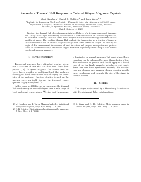 | 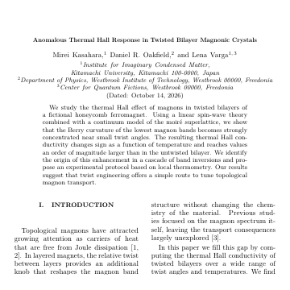 | 本文 6.0pt / タイトル 5.1pt イントロ：あり 組版 4.1 秒 |  |
| 天文学 | Monthly Notices of the RAS `mnras` | 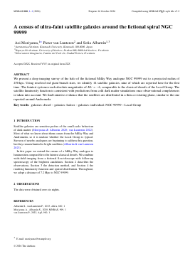 | 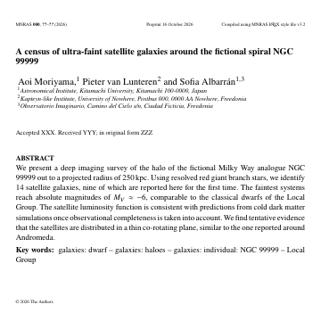 | 本文 5.4pt / タイトル 6.9pt イントロ：なし 組版 3.7 秒 | ・テンプレートどおり newtxtext を読み込んでいる ・本文 6pt では著者と Abstract が印刷範囲に収まらないため、5.4pt に下げて組みました ・Abstract の下の余白が 1.2 mm しかないため、イントロは入れませんでした（本文の文字サイズを小さくすると入ります） |
| 天文学 | ApJ・AJ など AAS の雑誌（aastex701） `aastex701` | 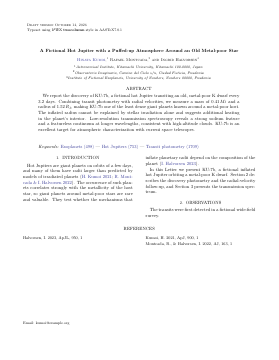 | 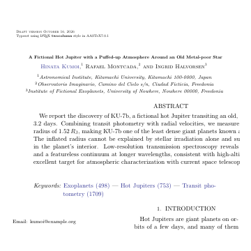 | 本文 6.0pt / タイトル 4.3pt イントロ：あり 組版 8.7 秒 | ・既知の不具合：Abstract が右にずれて右端が切れる（AASTeX が Abstract を元の本文幅の中央に置くため。原因は調査中） |
| 化学 | J. Am. Chem. Soc.（ACS） `achemso` | 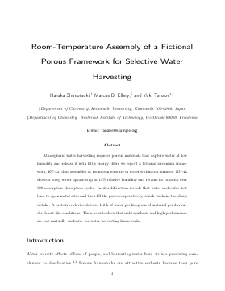 | 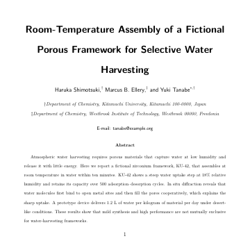 | 本文 4.7pt / タイトル 9.6pt イントロ：なし 組版 1.3 秒 | ・投稿用の書式（manuscript=article）。ACS の雑誌は出版時に組み直すため、掲載時の見た目ではない。arXiv では化学の 12 本中 1 本と少数 ・本文 6pt では著者と Abstract が印刷範囲に収まらないため、4.7pt に下げて組みました ・Abstract の下の余白が 1.4 mm しかないため、イントロは入れませんでした（本文の文字サイズを小さくすると入ります） |
| 生態学（Elsevier） | Elsevier の雑誌全般（例：生態学） `elsarticle` | 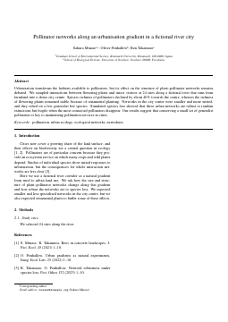 | 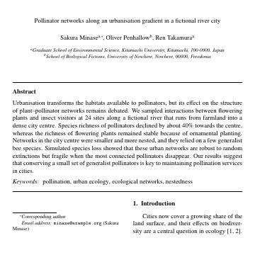 | 本文 6.0pt / タイトル 6.0pt イントロ：あり 組版 5.2 秒 | ・出版時の 2 段組に近い 5p オプション |
| 数学 | AMS の雑誌（amsart） `amsart` | 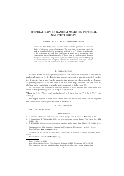 | 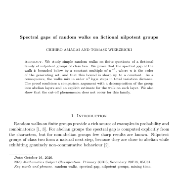 | 本文 6.0pt / タイトル 6.1pt イントロ：あり 組版 2.6 秒 | ・クラスは BusyTeX に入っている |
| 地球科学（Elsevier） | Elsevier の新しい 2 段組テンプレート（cas-dc） `cas-dc` | 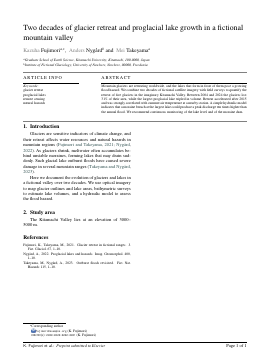 | 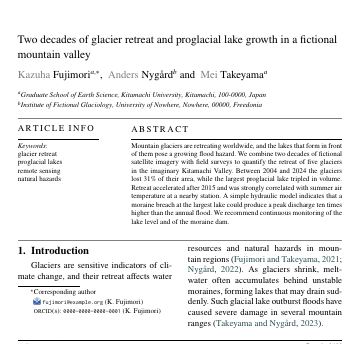 | 本文 6.0pt / タイトル 4.4pt イントロ：あり 組版 11.4 秒 |  |
| 電気電子・情報（参考） | IEEE の会議（IEEEtran） `IEEEtran` | 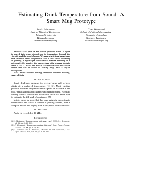 | 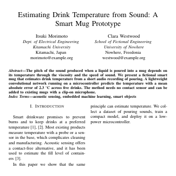 | 本文 6.0pt / タイトル 10.2pt イントロ：あり 組版 2.1 秒 | ・この PoC で最初に対応したクラス |
| 統計学など（汎用） | arXiv のプレプリントで最多の汎用クラス（article） `article` | 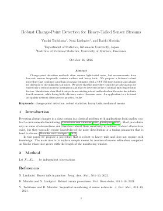 | 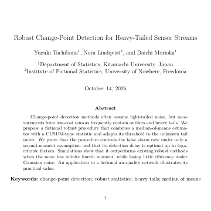 | 本文 6.0pt / タイトル 8.0pt イントロ：なし 組版 2.5 秒 | ・余白 1 インチ・著者ブロック・natbib という典型的な書き方 ・Abstract の下にイントロが入らなかったため、イントロ無しで出力します（本文の文字サイズを小さくすると入ります） |
